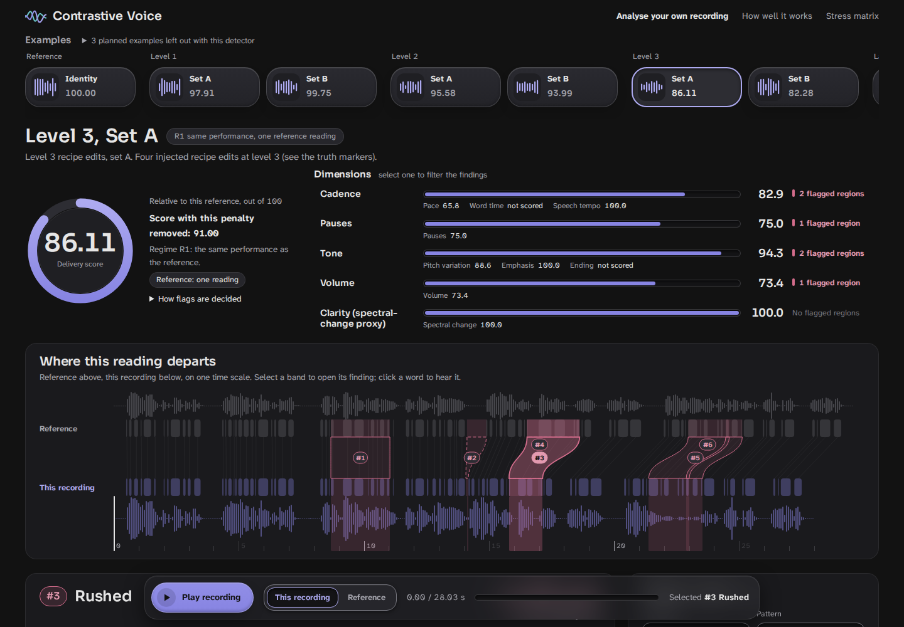

# Contrastive Voice

Team **Void**: Multimodal AI Hackathon 2026, Track C.

The frozen detector is also published on Hugging Face: [WinterBlossom/contrastive-voice](https://huggingface.co/WinterBlossom/contrastive-voice). The same file is `models/detector.json`; to fetch it on its own:

```bash
hf download WinterBlossom/contrastive-voice detector.json --local-dir models
```

Contrastive Voice compares a spoken reading with a reference reading of the same words. It aligns both recordings word by word, measures pace, pauses, pitch range, emphasis, volume, a spectral-change proxy for clarity and speech tempo, and marks each time span where the reading departs from the reference by more than a calibrated threshold. Each finding names the words, gives both measured values and the threshold, states the points it costs in a reference-relative score, suggests a fix, and has A/B playback of the span in both recordings. The detector is a calibrated threshold detector (no trained classifier). It was built for Track C of the Multimodal AI Hackathon 2026 (contrastive speech analytics and temporal flaw grounding).



The screenshot shows the local app on the gallery example **Level 3, Set A**: the Reagan passage with four injected level-3 edits, compared with the unedited recording (regime R1). The score is 86.11. Six flagged regions are listed on the right; the selected finding **#3 Rushed** gives the words, both time spans, the measurement (0.87 s against 1.62 s), the 4.89 points it costs and a fix. Below are the waveform, the pitch and level contours, and one row per dimension with its tolerance band.

**Documents:** [technical report](docs/technical.md) ([PDF](docs/technical.pdf)) · [source of every number](docs/NUMBERS.md) · [grounding in prior work](docs/GROUNDING.md) · [papers used](docs/PAPERS.md) · [pre-registered evaluation plan](docs/FINAL_EVALUATION_PLAN.md) · [research reports](docs/research/)

## Where each judging criterion is covered

| Criterion (weight) | Technical report | Code and evidence |
|---|---|---|
| Data engineering and stress testing (30 %) | §2 Data engineering, §6.4 Stress matrix | `kaggle/data/fetch.py`, `src/cvoice/dataset.py`, `flaws.py`, `edits_extra.py`, `r2pool.py`, `stress.py`; [dataset card](docs/evidence_final_782d7df7/dataset_card.md); **Stress matrix** panel in the app |
| Causal explainability and temporal grounding (25 %) | §5 Causal explainability and temporal grounding | `src/cvoice/patterns.py`, `explain.py`, `score.py`; every finding in the app (words, time spans, measured values, threshold, points, fix, A/B playback) |
| Feature extraction (20 %) | §3 Feature extraction, §4 Detection and calibration | `src/cvoice/align.py`, `features.py`, `compare.py`, `detect.py`, `calibrate.py`; [grounding in prior work](docs/GROUNDING.md) |
| Dashboard (15 %) | §7 Dashboard | [Quick start](#quick-start) below; `src/cvoice/app.py`, `src/cvoice/static/` |
| Reproducibility and code quality (10 %) | §8 Reproducibility and code quality | [Reproduce from public origins](#reproduce-from-public-origins), [Tests](#tests); [source of every number](docs/NUMBERS.md); `uv.lock`, `Dockerfile`, `.github/workflows/ci.yml` |

## Three regimes

The numbers of one regime say nothing about another. They are never pooled.

| Regime | What is compared | Where it occurs | What is flagged and scored |
|---|---|---|---|
| **R1, same recording** | A reading against an unedited copy of the same recording, with synthetic edits injected | All evaluation clips with known edits; the gallery examples marked R1 | Pace, pauses, pitch range, emphasis, volume, clarity proxy, speech tempo. Word time and ending are listed, not scored |
| **R2, different speaker, one reference** | A reading against one reading of the same text by another person | Every upload against the bundled Reagan passage or an own reference recording | Pace, pauses, pitch range and volume, with wide thresholds (for example a local pace flag needs ×2.19 slower or ×0.45 faster speech). Emphasis and clarity are shown, word time, ending and speech tempo are listed; none of them is scored |
| **R2, different speaker, median of five** | A reading against the word-by-word median of five other readings of the same text | Uploads against the bundled Gettysburg Address bank (six LibriVox readings) | As R2 with one reference, with its own thresholds |

The R1 F1 measures how well the tool finds edits inside one recording. It does not measure a comparison between two readers, which is what every upload is.

## Headline results

Final evaluation, detector configuration `782d7df7…` (`models/detector.json`, sha256 `d5935d3f…`), run on Kaggle (2 × T4) on 2026-10-07 IST; the test split was evaluated once with this configuration. Evidence: [`docs/evidence_final_782d7df7/`](docs/evidence_final_782d7df7/); source of each number: [`docs/NUMBERS.md`](docs/NUMBERS.md).

**R1, same recording.** Strict event F1 for the 8 core edit types at levels 2 and 3 (one-to-one matching; windowed regions need IoU ≥ 0.5). Validation and test have 2 speakers each, so per-speaker values are given, not confidence intervals.

| Split | Pre-registered: all predictions counted (TP/FP/FN, F1, per speaker) | One detection per change, introduced after the plan (TP/FP/duplicates/FN, F1, per speaker) |
|---|---|---|
| Validation | 30/13/2, **0.800** (0.769, 0.833) | 30/9/4/2, 0.845 (0.811, 0.882) |
| Test | 28/9/4, **0.812** (0.800, 0.824) | 29/5/3/3, 0.879 (0.848, 0.909) |

- The test split was evaluated once before, on 2026-10-02, with an earlier detector configuration (`32cdd86f…`, without the speech-tempo key, all predictions counted): F1 0.879 (29/5/3). That result was seen before the redesign. Its evidence is kept in [`docs/evidence_final_32cdd86f3d6e/`](docs/evidence_final_32cdd86f3d6e/).
- Level 1 (the mildest edits), test: 0.286 pre-registered, 0.476 one detection per change.
- Unedited copies of the test recordings (identity and 5 placebo variants): 0 false regions in 5.89 comparison-minutes.
- Natural rushing (speech tempo): 4 of 18 edits found at levels 2–3 (train 2/10, validation 1/4, test 1/4).

**R2, different speaker.** Held-out readers of the same texts (the lockbox: Speech Accent Archive and LibriVox poetry readers only), with no edits; false regions per comparison-minute, the two sources weighted equally:

| Reference | False regions per minute (bootstrap upper 95 %) | Whole-passage false flags per clip |
|---|---|---|
| One reference | 0.46 (0.54) | 0.057 |
| Median of five | 0.52 (0.68) | 0.084 |

The budget was 0.5 false regions per minute and 0.05 whole-passage flags per clip; it is not established at the upper 95 % bound in any R2 set. Detection in R2 has no held-out test with known edits: on three check readers used during development, level-3 edits were found for monotone 17 of 18, volume fade 13 of 18, dropped pause 4 of 17 and rush 1 of 18 (one reference).

Full results, the stress matrix, baselines and the cause-label accuracy are in the [technical report](docs/technical.md).

## Quick start

### Prerequisites

- Linux x86-64, macOS arm64 or Windows x86-64 (the platforms in `uv.lock`).
- [uv](https://docs.astral.sh/uv/) 0.12.x (`pyproject.toml` requires `>=0.12.3,<0.13`), for example `curl -LsSf https://astral.sh/uv/0.12.3/install.sh | sh` on Linux and macOS. uv installs Python 3.12 if it is missing.
- `ffmpeg` on `PATH` (decodes uploads), for example `sudo apt-get install ffmpeg` or `brew install ffmpeg`.
- Network access on the first analysis: torchaudio downloads the wav2vec2 alignment checkpoint (377,664,473 bytes; its size and SHA-256 are checked). Browsing the gallery needs no checkpoint.
- Optional: Docker; a Kaggle account and the Kaggle CLI (full rebuild).

### Install

Dependencies are declared in `pyproject.toml` and pinned in `uv.lock` (numpy, scipy, soundfile, soxr, praat-parselmouth, cmudict, FastAPI, uvicorn, python-multipart, torch and torchaudio 2.10.0).

```bash
git clone https://github.com/WinterBlossom0/contrastive-voice.git
cd contrastive-voice
uv sync --locked --extra cpu
```

The extras `cpu` and `gpu` are mutually exclusive; `gpu` installs the CUDA 12.6 wheels and is used on Kaggle. Add `--group dev` for the tests and `--group build` for dataset building, calibration, evaluation and the gallery rebuild.

### Run the app locally

```bash
uv run --extra cpu python -m cvoice.app
```

Open `http://127.0.0.1:7860`. Options: `--host`, `--port`, `--gallery DIR`, `--detector FILE` (default `models/detector.json`, the frozen detector). `GET /api/health` reports whether analysis is available.

**Gallery.** The page opens on a precomputed example. The **Examples** rows hold 17 examples, each with its score: **Identity**, **Level 1** to **Level 3** (**Set A**, **Set B**), the **Ladder** (**G1**, **G3**, **G5**), **Other performance** (**Greenman**, **Greenman edited**, **Greenman botched**, **Listed entries**, **Median of five**), **Channel** (**MP3 64 kbit/s**) and **Natural rushing**. **How well it works** shows the evaluation (pre-registered accounting first); **Stress matrix** shows how the output moves when only the recording conditions change.

**Upload your own reading.** Open **Analyse your own recording**, choose your file under **Your recording**, pick a **Reference** (the bundled Reagan passage, one reading; the bundled Gettysburg Address, median of five readings; or your own reference recording), fill in **Transcript: the exact words both recordings read** (or load it from a text file), and press **Analyse**. The page shows the stages decode, align, features, compare and detect while the job runs. Every upload is analysed as R2. Limits: 50 MiB per request, 180 s per recording, one analysis at a time. A recording whose words do not match the transcript is refused.

The same analysis from the command line (use `--regime R1` only for an edited copy of the reference recording itself):

```bash
uv run --extra cpu python -m cvoice.pipeline --participant my_reading.wav --baseline gallery/audio/reagan_farewell_1989.wav \
  --transcript words.txt --regime R2 --out result.json
```

### Run with Docker

```bash
docker build -t cvoice .
docker run --rm -p 7860:7860 cvoice
```

Open `http://localhost:7860`. The image uses Python 3.12, ffmpeg and the locked CPU environment, runs as a non-root user and bakes in the verified alignment checkpoint, so the container needs no network at run time. The image was not built during the final checks of this repository.

### Static gallery (no server)

```bash
uv run --extra cpu python -m cvoice.gallery site out/pages
uv run --extra cpu python -m http.server 8000 --directory out/pages
```

Open `http://127.0.0.1:8000`. `out/pages` holds the page, the vendored scripts and the gallery data, ready for GitHub Pages. The static site plays the examples; uploads need the local server.

## Reproduce from public origins

Everything is rebuilt on Kaggle with your own account; no access to the owner's private datasets or kernels is needed. All Kaggle outputs stay private, because some corpora have non-commercial licences.

1. **External corpora (fetch kernel).** `kaggle/data/fetch.py` downloads the reader corpora from their origins, checks each member against its published size and CRC, and writes source tars, `manifest.json`, `LICENSES.md` and `STATUS.json`. In `kaggle/data/kernel-metadata.json` set `id` to `YOUR_USERNAME/cvoice-data`, keep the five public `dataset_sources` and `is_private`/`enable_internet` true, then:

   ```bash
   kaggle kernels push -p kaggle/data
   ```

   Check its `STATUS.json` for failed sources. The build also looks for a second output named `cvoice-data-vctk`: make a copy of the kernel with id `YOUR_USERNAME/cvoice-data-vctk` whose entry point calls `main(["--only", "vctk"])`. The build checks that this mount exists but does not use VCTK audio.
2. **Source recordings.** `data/sources_manifest.json` lists the 19 source recordings (9 baseline speeches, LibriVox readings) with download URL, SHA-256 and licence basis. You can upload them as your own private `cvoice-sources` dataset, or leave it out: `kaggle/run.py` then downloads each file from its origin and stops on any hash mismatch. Before that, replace the placeholder contact URL in `SOURCE_USER_AGENT` (`kaggle/run.py`, line 108) with a URL at which Wikimedia can reach you.
3. **Project snapshot.**

   ```bash
   scripts/stage_project.sh
   ```

   This writes `build/cvoice-project/` (source, `uv.lock`, manifests, transcripts; no audio). Change `id` in `build/cvoice-project/dataset-metadata.json` to `YOUR_USERNAME/cvoice-project`, then upload it as a private dataset:

   ```bash
   kaggle datasets create -p build/cvoice-project --dir-mode zip --keep-tabular
   ```
4. **Build kernel.** In `kaggle/kernel-metadata.json` set `id` to `YOUR_USERNAME/cvoice-build`, `dataset_sources` to your `cvoice-project` (and `cvoice-sources` if you made it), and `kernel_sources` to your `cvoice-data` and `cvoice-data-vctk`. Keep `is_private` and `enable_internet` true. Then:

   ```bash
   kaggle kernels push -p kaggle
   ```

   `kaggle/run.py` detects the GPUs, checks the staged source hashes, syncs the locked environment and runs four stages: dataset build, calibration, evaluation, gallery. The final run took 7228.9 s, about 2 h, on 2 × T4 (bootstrap 167.7 s, dataset 1364.8 s, calibration 1135.8 s, evaluation 4402.5 s, gallery 51.3 s). Do not set a timeout shorter than that. The kernel always exits 0; the outcome is in `STATUS.json` (`complete: true`, empty `failed_stages`).
5. **Download and check.**

   ```bash
   kaggle kernels output YOUR_USERNAME/cvoice-build -p build/run
   scripts/import_run.sh build/run
   ```

   The importer checks `SHA256SUMS` and `STATUS.json`, refuses a run whose record of final evaluations lost an entry, and replaces `data/dataset/`, `gallery/`, `docs/evidence/` and the JSON files in `models/`. To compare with the owner's run: the dataset manifest of the final run has sha256 `d67c9cd9…` (the development run before it gave the same manifest), and the detector configuration is `782d7df7…` (`STATUS.json` `detector.config_sha256`).

**Test split.** A default run evaluates train and validation only (`FINAL_DEFAULT = False` in `kaggle/run.py`). The test split and the R2 lockbox are evaluated only with `evaluate --final`, which records the configuration hash in `models/final_evaluations.json` before it computes a test number and refuses a second run for the same hash unless `--force` is given. That record already holds `782d7df7…` and the earlier `32cdd86f…`, and it travels with the staged project.

**Outputs computed after the final evaluation (local CPU).** The evaluation addendum (both accountings with per-speaker values, cause-label accuracy, a CPU re-run of the frozen detector on the saved audio) and the shipped gallery were computed from the saved run outputs, with no new Kaggle run. For a run folder that holds `eval/`, `models/`, `calibration/` and `data/dataset/` (the unzipped run output):

```bash
uv sync --locked --extra cpu --group build
scripts/rebuild_after_final.sh RUN_DIR docs/evidence_final_32cdd86f3d6e/results.json
```

The script refuses a run whose `detector.json` differs from the repository's frozen detector. It writes `RUN_DIR/eval/addendum.{json,md}` (`python -m cvoice.addendum`), re-renders `RUN_DIR/eval/tables_rendered.md`, rebuilds the gallery with the frozen detector on CPU, and replaces `gallery/`. In the owner's run the CPU re-run reproduced the saved strict counts in 24 of 24 rows.

## Tests

```bash
uv sync --locked --extra cpu --group dev --group build
uv run --extra cpu pytest -q
uv run --extra cpu pytest -q -m slow tests/test_smoke.py
uv run --extra cpu ruff check --select F,E9 src kaggle tests
```

The second command runs 561 tests (all pass, about 85 s on a laptop CPU); two slow tests are deselected by default. The third runs the one-clip smoke test (it needs the alignment checkpoint; about 6 s once the checkpoint is cached). The other slow test (`tests/test_integration.py`, a mini dataset build through the gallery) did not finish on the laptop and was not run for the final checks. A few tests read the final-run outputs under `build/`, which is not part of the repository; in a fresh clone they are skipped. `.github/workflows/ci.yml` runs the first three commands.

## Repository layout

| Path | Contents |
|---|---|
| `src/cvoice/` | Analysis: `config`, `audio`, `align`, `features`, `reference`, `compare`, `detect`, `patterns`, `score`, `explain`, `pipeline`. Build and evaluation: `passages`, `flaws`, `edits_extra`, `dataset`, `r2pool`, `pool`, `calibrate`, `protocol`, `evaluate`, `events`, `stress`, `uncertainty`, `addendum`, `gallery`, `lab/` (measurement lab). Dashboard: `app.py`, `static/` |
| `models/detector.json` | The frozen detector: scales, thresholds and score constants for R1, R2 and R2 median of five |
| `models/final_evaluations.json` | Record of test-split evaluations (configurations `32cdd86f…` and `782d7df7…`) |
| `gallery/` | 17 precomputed examples (audio and result JSON), the evaluation panel and the stress matrix shown on the page; rebuilt on CPU after the final evaluation with the frozen detector (`gallery/index.json` `provenance`) |
| `data/sources_manifest.json`, `data/transcripts/` | The 19 source recordings (URL, SHA-256, licence basis, split) and the transcript snapshots with their hashes |
| `data/dataset/` | An earlier public-domain-only dataset build (manifest `8db28b8b…`, 9 baselines, 10 readers, 110 edited clips). It is not the final-run dataset (manifest `d67c9cd9…`, 2410 files, 1109.2 minutes), which includes non-commercial reader corpora and is rebuilt on Kaggle |
| `docs/technical.md`, `docs/technical.pdf` | Technical report |
| `docs/NUMBERS.md`, `docs/GROUNDING.md`, `docs/PAPERS.md` | Source of every number; chain from the literature to each measure; papers used |
| `docs/research/` | The research reports that record each cited paper as read, and the lab decisions |
| `docs/FINAL_EVALUATION_PLAN.md` | Plan for the final evaluation, written before it ran |
| `docs/evidence_final_782d7df7/`, `docs/evidence_final_32cdd86f3d6e/` | Evidence of the final evaluation and of the earlier look at the test split |
| `docs/DESIGN.md` | The original build contract, written for the 2026-10-02 detector; not the final numbers |
| `kaggle/run.py`, `kaggle/data/fetch.py`, `kaggle/lab/` | Build kernel, corpus fetch kernel, measurement lab kernel |
| `scripts/` | `stage_project.sh`, `import_run.sh`, `rebuild_after_final.sh`, `build_pdf.sh`, `make_pipeline_figure.py` |
| `tests/` | Unit and regression tests |
| `pyproject.toml`, `uv.lock`, `Dockerfile` | Locked environment and container |

## Data and licences

- **Baselines and gallery audio.** The 9 baseline speeches are public-domain US government recordings (Wikimedia Commons). The reader recordings in the gallery (Gettysburg Address, Reagan farewell address read by John Greenman) are LibriVox readings dedicated to the public domain. All audio in this repository derives from these sources. `data/sources_manifest.json` and the dataset card give the source URL and licence basis of each.
- **Reader corpora for the R2 calibration and lockbox** (final-run dataset): Speech Accent Archive (779 recordings, CC BY-NC-SA 4.0), EARS (856 recordings, CC BY-NC 4.0), and LibriVox poetry and Gettysburg readings (308 recordings, public domain). They are used under their own terms for calibration and evaluation. Their audio is not in this repository; it stays in private Kaggle outputs and is rebuilt from the origins by `kaggle/data/fetch.py`, which writes the licence of each source to `LICENSES.md`.
- No data is redistributed against its licence.
- Third-party components keep their own licences: torchaudio `WAV2VEC2_ASR_BASE_960H` (alignment), Praat through parselmouth (pitch), the WORLD vocoder through pyworld (build only), `cmudict` (syllable counts), Plotly (MIT) and wavesurfer.js (BSD-3-Clause), vendored in `src/cvoice/static/vendor/`.
- Code licence: not yet chosen by the owner.

## AI assistance

The AI tool used is Claude Code. The research (literature and data-source reports), the source code and tests, the data pipeline and Kaggle kernels, the calibration and evaluation, the dashboard, and the documents (this README, the technical report, the grounding and number-source files) were produced with Claude Code under the owner's direction. The owner made the design decisions: scope and flaw types, the data sources and their use, the threshold-only detector, the speaker splits, the evaluation rules and the decision to run the final evaluation once.

## Limits

Short forms; the full wording and numbers are in section 9 (Limits) of the [technical report](docs/technical.md).

- The accuracy figures (F1) are for edits inside one recording. An upload is compared with another reader, and there only large changes are flagged: pace ×2.19 slower or ×0.45 faster, a pause 1.5 s shorter.
- Every upload is compared with a different reader. This comparison has no held-out test with known edits. On development readers it found most strong monotone (17 of 18) and volume-fade (13 of 18) edits, but few strong rush (1 of 18) or dropped-pause (4 of 17) edits.
- On held-out readers, about one false flag every two minutes (0.46/min; up to 0.54/min). Readers whose first language is not English get more false flags (Amharic 1.3/min, Arabic 1.0/min).
- Test F1 0.81 (0.88 when duplicate detections of one change count once) from 2 test speakers; the test set was also scored once with an earlier version. All 9 baseline speakers give US political addresses.
- Natural rushing was found in 4 of 18 synthetic edits (levels 2–3), with approximate edges. Speech tempo is the least reliable measure: background noise can raise false speech-tempo flags. For a different speaker it is listed, not scored.
- Pace, pause and speech-tempo values come from automatic word alignment. Noise, filtering or a change of voice quality can move word boundaries, so a timing flag can appear where the timing did not change.
- Pause findings are placed within about 0.15 s. Pace, pitch-range, volume and clarity findings mark an approximate five-word span.
- Robustness was tested with simulated noise, babble, compression, phone and room effects only. Background talk and phone audio produce many false pause and pace flags.
- Scores and cause labels were checked only against synthetic edits with a known cause, not against listener ratings.
