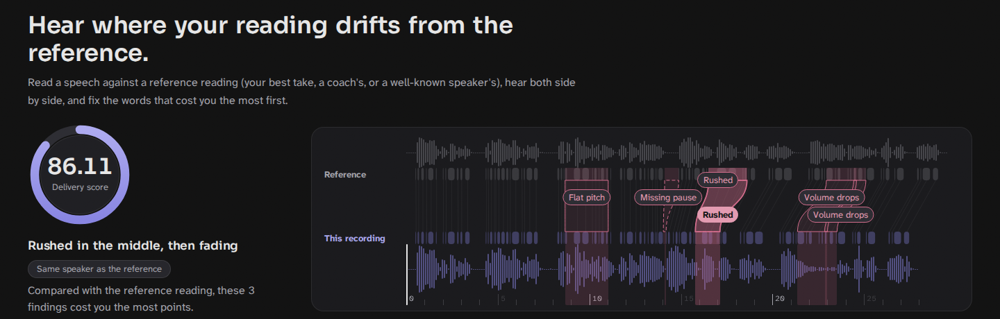

**Summary.** Contrastive Voice aligns a reading with a reference reading of the same words, measures nine delivery quantities (D1 to D9) at the same words in both, and returns time-stamped flagged regions with a measured explanation, a cause label and a cost in points. In regime R1 (an edited copy of the reference recording), core-8 test event F1 at levels 2–3 is **0.812** under the pre-registered accounting (all predictions counted; TP 28, FP 9, FN 4; per speaker 0.800 and 0.824) and 0.879 when duplicate detections of one change count once (an accounting introduced after the plan). The test split was scored once before, on 2026-10-02 under an earlier configuration (`32cdd86f…`, all predictions counted: 0.879). In regime R2 (a different reader, the regime of every upload), held-out readers give 0.46 false regions per comparison-minute (upper 95 % bound 0.54) with one reference; level-3 rush and dropped-pause edits are mostly missed (1 of 18, 4 of 17). Every flaw is a synthetic signal edit; no listener has rated the clips. Sources of numbers: `docs/evidence_final_782d7df7/`; papers and citation chains: `docs/PAPERS.md` (same reference numbers).

*Judging criteria:* data engineering and stress testing, sections 2 and 6.4; causal explainability and temporal grounding, 5; feature extraction, 3 and 4; dashboard, 7; reproducibility and code quality, 8.

# 1. Problem and approach

Judging rubrics name delivery problems ("poor pacing", "speaks in monotone", "too soft") but give no numeric thresholds [1–4], and trained raters agree poorly on vocal delivery: two expert raters gave the same "vocal expression" score on 30 % of presentations [2]. The system therefore does not score absolute values. It compares a performance with a reference rendition of the same text, word by word, as coaching systems and reference-based prosody evaluation do [32, 103]: both recordings are force-aligned to the transcript, each quantity is measured on the same words, and a difference is flagged when it exceeds a threshold fitted on comparisons without flaws (nulls). The detector is a threshold rule; there is no trained classifier.

| Regime | Participant compared with | Thresholds fitted on | Scored keys | Where it is used |
|:------------|:--------------------------|:------------------------|:---------|:------------------------|
| R1 same recording | an edited copy of the reference recording | train split: identity and placebo nulls, labelled edits | D1–D6, D9 | evaluation clips; gallery examples marked R1 |
| R2 single | one reading of the same text by another person | fit set of the R2 null pool (985 readers) | D1, D2, D3, D5 | every upload against the bundled Reagan passage or an own reference |
| R2 consensus of 5 | the word-by-word median of five other readings | the same fit set, five references per comparison | D1, D2, D3, D5 | uploads against the bundled Gettysburg bank (six readings) |

Regimes are never pooled. The R1 F1 measures recovery of edits inside one recording, not a comparison between two readers, which is what every upload is (`app.py`, `UPLOAD_REGIME = "R2"`).

# 2. Data engineering

**Sources and licences.**

| Source | Role | Recordings | Licence |
|:--------------------------------|:------------------------------------|:--------------|:--------------|
| US government speeches, Wikimedia Commons | baselines, split by speaker 5 train / 2 val / 2 test | 9 (passages 21.4–31.1 s, 51–91 words) | public domain |
| LibriVox Gettysburg Address; Greenman reading of the Reagan passage | R2 calibration bank (6), check readers (3), never-fitted pair (1) | 10 | public-domain dedication |
| Speech Accent Archive | R2 null pool | 779 | CC BY-NC-SA 4.0 |
| EARS (regular reading) | R2 null pool | 856 | CC BY-NC 4.0 |
| LibriVox poetry and Gettysburg readings | R2 null pool | 308 | public domain |

Non-commercial audio is used under its licence terms for calibration and evaluation only. It is not in the repository; it stays in private Kaggle outputs.

**Rebuild from public origins.** `data/sources_manifest.json` lists the 19 source recordings with URL, SHA-256 and licence basis; the build stops on a hash mismatch. `kaggle/data/fetch.py` downloads the reader corpora from their origins, checks each member's size and CRC, and writes `LICENSES.md`. `kaggle/run.py` then builds the dataset, calibrates, evaluates and builds the gallery. Two independent Kaggle builds (development run v13 on 2026-10-06 and the final run on 2026-10-07) produced byte-identical dataset manifests (sha256 `d67c9cd9…`).

**Flaw synthesis.** A flaw is a controlled edit of a clean recording at one of three levels, spliced back with exact word, sample and time labels. Stored clips use waveform-similarity overlap-add for duration and Praat PSOLA for pitch; a second generator used only in evaluation (chain B) uses Praat duration and WORLD-vocoder pitch. Identity and placebo clips pass the same processing. The tools are named without citation because their papers are not recorded as read (`docs/PAPERS.md`). Synthetic errors helped learned detectors of real errors [105], but a learned detector can also key on synthesis artefacts [106]; this detector learns nothing from the edits except its thresholds.

| Core type (dimension) | Edit | L1 | L2 | L3 |
|:---------------------|:---------------------------------------------|:---------|:---------|:-----------|
| RUSH / DRAG (D1) | speech time of the span ×1/r or ×r, pauses kept | 1.20 | 1.45 | 1.90 |
| PAUSE_DROPPED (D2) | pause of at least 0.5 s kept to fraction | 0.40 | 0.20 | 0.06 s left |
| PAUSE_INTRUSIVE (D2) | room tone inserted inside a phrase | 0.35 s | 0.60 s | 1.20 s |
| MONOTONE (D3) | share of the F0 range kept | 0.50 | 0.25 | 0 |
| DEEMPHASIS (D4) | stress removal strength | 0.5 | 0.75 | 1.0 |
| FADE (D5) | gain ramp down to | 4 dB | 8 dB | 14 dB |
| MUMBLE (D6) | spectral smoothing strength | 0.3 | 0.6 | 1.0 |

Fifteen further types from the research reports cover natural rushing (words ×1/1.13 to ×1/1.18, pauses shrunk), hesitation, word-by-word reading, uneven tempo, five disfluency types, low effort, trailing off, misplaced emphasis, two sentence-ending types and repeated contour. Each edit is measured again after synthesis; an edit that does not realise its intended change is recorded and excluded from truth. The final dataset records 118 realisation shortfalls (RISING_ENDING 53, LOW_EFFORT 28, FLAT_FINAL_FALL 21, REPEATED_CONTOUR 9, TRAILING_OFF 7); 82 events are excluded from evaluation truth.

**Dataset.** 2410 audio files, 1109.2 minutes: 9 baselines, 1953 reader recordings and 448 edited clips (162 single-level, 27 ladder rungs G1/G3/G5, 9 identity, 130 multi-edit botched clips of the extra types, 116 different-reader clips with edits, 4 botched different-reader clips). R1 single-level clips per split: train 90 (5 speakers), val 36 (2), test 36 (2). The dataset card lists every recording with its source and licence (`docs/evidence_final_782d7df7/dataset_card.md`).

**R2 null pool.** The 1943 null readings form 30 same-text groups from four sources (Speech Accent Archive 1, EARS 8, poetry 20, Gettysburg 1). Readers are split once, before fitting, into fit (985: scales and thresholds), select (707: budget check, never used for tuning) and lockbox (251 planned, Speech Accent Archive and poetry only, prepared only by `evaluate --final`; measured once on 192 accent and 45 poetry readers, 14 poetry readings excluded because their text was not located). Sources carry equal weight; inside a source, texts are weighted by comparison-minutes.

# 3. Feature extraction

**Alignment.** torchaudio `WAV2VEC2_ASR_BASE_960H` emissions and a CTC Viterbi pass over the supplied transcript give word start and end times at 20 ms resolution. The published word-boundary error of wav2vec 2.0 CTC alignment is 48 ms (TIMIT) and 89 ms (Buckeye) [100]; it was not measured on these recordings.

**Frames and windows.** Frames are 25 ms with a 10 ms hop. Level is frame dB minus the recording's median over voiced frames, so a uniform gain cancels. F0 is Praat's autocorrelation tracker [44] in two passes, the second with floor and ceiling from the recording's own quartiles [45], in semitones from the speaker's median [41]. A pause is the longest acoustically silent run of at least 0.20 s inside an inter-word gap [30, 32]. Window keys use centred five-word windows clipped at sentence boundaries and are centred on the clip median g, which is kept as a separate whole-clip measure for D1 and D3.

| Key | x = participant minus reference, at the same words | Unit | R1 | R2 | Basis |
|:-----------|:---------------------------------------------|:----|:------|:------|:----------------------|
| D1 pace | ln ratio of speech time (pauses removed) in the window, minus g | ln | scored | scored | articulation rate [14]; same-text comparison [26] |
| D2 pauses | silence at a word boundary; drops only where the reference pause is ≥ 0.5 s, insertions only at unpunctuated boundaries | s | scored | scored | pause thresholds [30, 32] |
| D3 pitch range | ln((P90 − P10 + 1 st) / same for reference), minus g; narrower only | ln | scored | scored | percentile range [43]; semitones [41] |
| D4 emphasis | loss of the stress statistic (mean of three robust z-scores of duration per syllable, P90 pitch, P90 level) at the reference's stress words | p | scored | shown | equal-weight prominence [57] |
| D5 volume | window mean level re own median, minus g; drops only | dB | scored | scored | level JND [66] |
| D6 clarity proxy | ln ratio of frame-to-frame change of MFCC 1–12, minus g; drops only | ln | scored | shown | clear-speech bundle [75]; no source validates this proxy |
| D7 word time | ln ratio of word occupancy (word plus orphan voiced time) | ln | listed | listed | disfluency methods [83, 85] |
| D8 ending | final 0.20 s minus earlier part of a sentence-final word | st | listed | listed | final pitch change [95] |
| D9 speech tempo | ln ratio of summed word durations in the window (not centred) | ln | scored | listed | tempo decomposition [19, 20] |

"Listed" means shown on the page and never scored. D7 stays listed because its lab gate failed on LibriStutter (word-duration ratio 0.39 found at 0.10 false) and no synthetic disfluency edit was recovered. D8 is listed by owner decision: the RISING_ENDING recipe mostly does not realise and val has 2 eligible ending events. D9 is listed in R2 by owner decision after 0 of 68 R2 rush positives in development run v13. D4 and D6 are shown and not scored in R2 by design (`config.REGIME_DIMS`). A pattern label is on only if it passed a real-data lab gate fixed before the results (12,868 recordings, 48 tests): natural rushing and the filled-pause candidate (PodcastFillers precision 0.54, recall 0.15) passed; six other labels failed and are off.

# 4. Detection and calibration

**Rule.** For key $k$, $z = x/s_k$ with $s_k = \max(\mathrm{floor}_k,\ 1.4826\,\mathrm{MAD},\ Q_{68}(|x|))$, weighted over the regime's nulls [104]. A region opens where $\mathrm{sign}\cdot z \geq h$ and extends over the contiguous run with $\mathrm{sign}\cdot z \geq \max(h/2,\ 0.5\,z_{\mathrm{peak}})$ (pitch range: $h/2$ only); sentence boundaries end runs; D2 and D4 are single events. Whole-clip flags compare g for D1 and D3 with their own thresholds.

**R1 selection (train only).** R1 nulls differ from the reference by almost nothing, so the scales sit at their floors. One h for D1–D6 is chosen on the training split to maximise joint in-sample strict F1 on core-8 and NATURAL_RUSH edits (L2+L3) plus the train controls, ties to the smaller h: **h = 2.15** (train selection objective, one-detection-per-change accounting with core-8 and NATURAL_RUSH edits and controls: F1 0.835, TP 76, FP 16, FN 14; 680 of 1000 bootstrap draws choose 2.15). D9 has its own h, constrained to give a threshold at or above the clean alignment-noise floor (0.1484 ln): **h = 3.05**, the lowest allowed grid value.

**R2 selection (fit set only).** Each enabled key takes the smallest h whose false regions per comparison-minute on the fit nulls stay within an equal share (0.0833) of a 0.5/min budget; whole-clip thresholds for D1 and D3 are the fit quantile of a separate clip budget (0.05 false clip flags per null clip, 0.025 per key). h is chosen on the point rate; the bootstrap upper bound is reported, not used.

| Key | R1 threshold | R2 single | R2 consensus of 5 | L3 edit |
|:-------------------------|:-----------------|:-------------------|:-------------------|:---------------|
| D1 pace, slower / faster | ×1.227 / ×0.815 | ×2.194 / ×0.452 | ×2.052 / ×0.581 | ×1.90 |
| D2 pause, inserted / removed | +0.3225 / −0.3225 s | +0.981 / −1.504 s | +1.008 / −0.805 s | +1.20 s / to 0.06 s |
| D3 pitch range kept | ×0.485 | ×0.273 | ×0.303 | 0 |
| D4 emphasis / D6 clarity | 1.075 p / ×0.619 | shown | shown | strength 1.0 |
| D5 volume | −4.3 dB | −10.08 dB | −9.0 dB | −14 dB |
| D9 speech tempo | ×0.862 | listed | listed | ×1/1.18 |
| Whole clip D1 / D3 (ln) | 0.223 / 0.693 | 0.612 / 0.702 | 0.392 / 0.506 | |

The R2 thresholds are set by how much two competent readers differ; they lie far above the perceptual values in [13, 40, 66] (limit 11).

**Scores.** The severity of a flagged unit is $\mathrm{clip}((|x|-\theta)/(a_k-\theta),\,0,\,1)$ with threshold $\theta = h\,s_k$ and a fixed saturation $a_k$ near the L3 magnitude (in R2 at least $2\theta$). Severities weighted by share of reference duration (or of events) sum to a penalty $P_k$; the key score is $S_k = 100\max(0,\,1 - P_k/P_{\max,k})$ and the overall score is the mean of the scored $S_k$. One factor (0.4584) scales every $P_{\max,k}$ and is fixed on train so that identity clips score 100, level-1 clips at least 90, G5 at most 50, and each ladder is non-increasing: 0 violations on train, val and test. Test medians: identity 100, G1 100, L1 99.3, G3 96.1, L2 94.7, L3 76.5, G5 45.9.

**Frozen detector.** `models/detector.json`, sha256 `d5935d3f…`, configuration `782d7df7…`; the repository file is byte-identical to the file the final evaluation measured.

# 5. Causal explainability and temporal grounding

**One change, one cause, one penalty.** One shared function (`patterns.py`) decides, for scoring, display and evaluation alike, which regions belong to one change. A D9 region near a D1 region of the same direction measures the same change (`SAME_CHANGE`), and the frozen secondary-exemption registry links, for example, a fade to the emphasis loss it causes; each group shows one title cause and costs one penalty. The rush cause is decided from the recipes' mechanism: core RUSH compresses words and keeps pauses; natural rushing also shrinks them [15, 16]. A D9 region is NATURAL_RUSH only when the reference has at least 0.20 s of pause around its words and the kept pause fraction is below both the word-time ratio and 0.775; otherwise it joins the RUSH change.

**Measured cause-label accuracy (R1, synthetic edits, val and test, L2+L3).** The shown label equals the injected type for 56 of 59 detected core-8 edits (DEEMPHASIS 4 of 7, shown twice as MONOTONE and once as RUSH) and for 7 of 13 detected synthetic-only edits (HESITATION 7 of 8; low effort and trailing off are shown as FADE). The RUSH/NATURAL_RUSH label is correct for every detected rush and natural-rush edit, all splits. The activation matrix (`docs/evidence_final_782d7df7/figures/activation_matrix.png`) shows which keys fire for which injected dimension; its D1→D9 cell is the same-change group, charged once.

**Temporal grounding.** Pause findings: over 16 val and test pause events the median edge error is 10 ms (onset) and 29 ms (offset); the largest 128 and 149 ms. Window findings have five-word resolution: 14 of 35 matched regions have both edges within 0.20 s (rush 4/7, drag 4/8, monotone 0/6, fade 3/6, mumble 3/8); the monotone onset error has a 90th percentile of 867 ms. The errors are measured against analytic edit labels, not hand-marked boundaries.

**Explanations.** Each finding is a template filled from measured values, with no language model (model output is not repeatable at settings called deterministic [117]). It gives the words and time spans in both recordings, both measured values, the threshold, a next step (goal, current state and next step [111]; specific and task-focused [113]), with the reference as the contrast [114], and a counterfactual: the score with this penalty removed [115], which is arithmetic on the score, not a re-analysis. Example (gallery, L3 set A, R1): *"Faster here: 15.80-17.14 s ('the Washington Monument, and then'). The word alignment measures 0.87 s of speech …; relative to the reference rendition it took 1.62 s at your overall tempo, 86% faster (3.0x the threshold; flagged above 23%). … score with this penalty removed: 91.0."* A cause claim needs evidence at the interventional level [116]. The repair test supplies it for synthetic edits: undoing the edit removes the flag in 12 of 12 (val) and 10 of 10 (test) repairs, and a placebo edit keeps it in 12 of 12 and 10 of 10.

# 6. Evaluation

## 6.1 Plan and accountings

A plan written on 2026-10-02, before any test number of this configuration existed, fixed the headline: R1, test split, levels 2–3, strict one-to-one event F1 with all predictions counted. Windows match at IoU ≥ 0.5; pause and emphasis events match by the labelled boundary or word; D7 and D8 need both edges within 0.20 s [107, 108]. The test split and the R2 lockbox are evaluated only by `evaluate --final`, once per configuration hash, recorded in `models/final_evaluations.json` [110]. The *one-detection-per-change* accounting, introduced after the plan, counts a same-change D9 region on a rush edit as its detection or as a duplicate, not as a false region. The test split was evaluated once before (2026-10-02, configuration `32cdd86f…`, no D9 key); that result was seen before the redesign (`docs/evidence_final_32cdd86f3d6e/`). The plan also fixed that both final results are reported side by side, that there is no third test run, and that validation speakers and the three check readers, inspected during the rework, count as development evidence; no design choice of the rework used a test result.

## 6.2 R1 results (same recording, synthetic edits)

Counts are TP/FP/FN (pre-registered) and TP/FP/same-change duplicates/FN (one per change). Train intervals are speaker-bootstrap percentiles over 5 speakers (coverage not assured); val and test give the two per-speaker values, not intervals.

| Core 8 | Pre-registered: TP/FP/FN, F1 (interval or per speaker) | One per change: TP/FP/dup/FN, F1 | Earlier final, 32cdd86f |
|:-------------------|:-------------------------------|:---------------------------|:-------------------|
| Train L2+L3 (in-sample) | 74/20/6, **0.851** [0.795, 0.907] | 76/8/10/4, 0.927 [0.885, 0.969] | 76/16/4, 0.884 |
| Val L2+L3 (development) | 30/13/2, **0.800** (0.769, 0.833) | 30/9/4/2, 0.845 (0.811, 0.882) | 30/12/2, 0.811 |
| **Test L2+L3** | 28/9/4, **0.812** (0.800, 0.824) | 29/5/3/3, 0.879 (0.848, 0.909) | 29/5/3, 0.879 |
| Test L1 (sensitivity) | 3/2/13, **0.286** | 5/0/0/11, 0.476 | 10/0/6, 0.769 |

Per type at test L2+L3 (one per change): 4 of 4 for each core type except MONOTONE 2 of 4 and DEEMPHASIS 3 of 4; pre-registered RUSH 3 of 4. Overlap view: 31 of 32 test edits are touched by a flag of their key, and 32 of 34 flags lie on an edit. Natural rushing (D9; lab-passed tier): 2/10, 1/4, 1/4 at L2+L3 (train/val/test), test F1 0.167 in both accountings. Synthetic-only tier, test L2+L3: F1 0.211 in both accountings; WORD_BY_WORD 0 of 28, because the D2 threshold (0.3225 s) is above every recipe silence (0.15–0.30 s). Unedited test copies (identity and 5 placebo variants): **0 false regions in 5.89 comparison-minutes** (val 0 in 5.93).

## 6.3 R2 results (different speaker)

| Null set (no edits), false regions per comparison-minute | One reference: rate (pooled) [upper 95] | Median of five | Whole-clip flags per clip (one / five) |
|:---------------------------|:-------------------------|:-----------------------------|:---------------|
| Fit (used to set thresholds) | 0.491 (0.450) [0.545], met | 0.468 (0.457) [0.564], met | 0.046 / 0.050 |
| Select (checked, not tuned) | 0.549 (0.482) [0.640], not met | 0.536 (0.401) [0.670], not met on covered sources | 0.046 / 0.068 |
| **Lockbox (held out, once)** | **0.460** (0.522) [0.538], met on covered sources | **0.516** (0.530) [0.684], not met on covered sources | 0.057 / 0.084 |

Rates weight sources equally; the budget is 0.5/min and 0.05 per clip. The lockbox covers Speech Accent Archive and poetry readers only. R2 detection has no held-out positive test: on the 3 development check readers (single reference, level 3) the tool finds MONOTONE 17/18, PAUSE_INTRUSIVE 14/18, FADE 13/18, HESITATION 13/18, LOW_EFFORT 11/18, DRAG 6/17, PAUSE_DROPPED 4/17 and RUSH 1/18; the never-fitted Greenman–Reagan pair finds 4 of 36 away-edits. Whole-passage edits, single reference, levels 1/2/3 of 18 pairs: rush 0/1/11, monotone 14/18/18; 2 of 18 unedited pairs are flagged. Check-reader nulls: 2 whole-clip pitch-range flags in 7.76 comparison-minutes.

## 6.4 Stress matrix: measured degradation

Eleven channel conditions are applied to the participant only; each row reports false regions added per minute and the share of original detections kept (pass rule removed). Val and test have 2 speakers each; per-speaker values and per-key rates are in `stress_by_speaker` of the addendum (`docs/evidence_final_782d7df7/addendum.json`).

| Condition | R1 val: added/min, kept | R1 test: added/min, kept | R2 check readers, one reference: added/min |
|:---------------------------|:-----------------------|:-----------------------|:-----------------------|
| Gain +6 / −6 dB | 0.21, 1.00 / 0.28, 1.00 | 0.14, 1.00 / 0.28, 1.00 | 0 / 0 |
| MP3 64 kbit/s | 0.07, 1.00 | 0.14, 1.00 | 0 |
| Low-pass 3.4 kHz | 0.38, 0.96 | 1.46, 0.94 | 0 |
| WORLD speaker transform | 0.94, 0.96 | 0.76, 0.99 | 0 |
| Room reverb RT60 0.4 s | 0.89, 0.95 | 0.61, 0.99 | 0 |
| White noise 20 dB SNR | 2.63, 0.91 | 1.85, 0.91 | 0.26 |
| Phone band + mu-law | 1.84, 0.89 | 5.52, 0.87 | 0.39 |
| Dynamic-range compression | 6.48, 0.78 | 2.60, 0.76 | 0 |
| Babble 20 dB SNR | 8.41, 0.89 | 13.2, 0.85 | 0.13 |
| Babble 10 dB SNR | 24.5, 0.65 | 26.2, 0.60 | 2.06 |

The R2 zeros rest on 7.76 check-reader minutes; limits 4 and 17 give the per-key and per-speaker breakdown.

## 6.5 Baselines

| Core 8, L2+L3, F1 | Val | Test |
|:---------------------------------------------------------------------|:--------------|:--------------|
| Detector, pre-registered / one per change | 0.800 / 0.845 | 0.812 / 0.879 |
| Flag everything / random regions | 0.016 / 0.045 | 0.016 / 0.056 |
| Reference-free (participant against itself), detector h / train-chosen h 2.75 | 0.217 / 0.218 | 0.247 / 0.261 |
| Reference-free with its own scales and h (added after the final evaluation) | 0.295 | 0.407 |

The baseline rows use the one-detection-per-change accounting; no pre-registered value was computed for them. The reference-free rows test the contrastive claim: without a reference reading the same measurements find fewer edits with more false regions (test, own scales: TP 12, FP 15, FN 20).

## 6.6 Further checks

*Directional test:* a higher level should not raise the edited key's score; 5 violations in 205 cells (two charged to a linked key, two unmeasured pauses, one non-monotone measured change). *Chain B:* 24 A/B pairs, 22 detections on each chain, equal false regions on every pair. *Internal consistency:* lowest median ratio of detector measurement to realised change, test MONOTONE L3 0.436 (circular for recipe families). *Device:* 6 clips, 8 recordings, GPU against CPU, 0 ms word-time difference, identical flags. *Repeatability:* two analyses of one clip give byte-identical JSON (89,227 bytes).

# 7. Dashboard

A FastAPI server and one static page. Cards follow the brief's categories (Cadence: pace, word time, speech tempo; Pauses; Tone: pitch variation, emphasis, ending; Volume; Clarity proxy); each key is marked scored, listed or not scored, with the reason. Charts overlay both recordings on the participant's time axis with tolerance bands, flagged regions and injected-edit markers. Panels give the evaluation (pre-registered accounting first) and the stress matrix. Uploads (up to 180 s) are analysed in R2 against the Reagan passage, the Gettysburg bank (median of five) or an own reference, with stage progress. The 17 gallery examples were rebuilt on CPU with the frozen detector after the final evaluation. A browser harness checks every example against its result JSON at 320 to 1440 px: 0 failures, 0 console errors.

{width=58%}

# 8. Reproducibility and code quality

The final run was one Kaggle kernel (cvoice-build version 19, 2 × T4): dataset 1364.8 s, calibration 1135.8 s, evaluation 4402.5 s (lockbox 117.8 s), gallery 51.3 s, bootstrap 167.7 s; 7228.9 s in total, `STATUS.json` complete with no failed stage. The kernel checks the staged source hashes and installs the locked environment (`uv.lock`). Hashes: dataset manifest `d67c9cd9…`, detector `d5935d3f…`, configuration `782d7df7…`, `results.json` `49a306d9…`. The evaluation addendum and the gallery were computed afterwards on CPU from the saved outputs (`scripts/rebuild_after_final.sh`); its re-run of the frozen detector on the saved audio of 162 clips reproduces the saved counts in 24 of 24 rows. Tests: 561 passed, 2 slow tests deselected (2026-10-08 IST); `ruff check --select F,E9` is clean. The evidence of this evaluation is in `docs/evidence_final_782d7df7/` with `SHA256SUMS`; `README.md` gives the rebuild steps.

# 9. Limits

\begingroup\footnotesize

Stated limits of the final run, in their agreed wording, numbered as in the review that confirmed them.

**1. Speech tempo (D9) cannot resolve the natural-rush recipe.** Speech tempo (D9) cannot separate mild natural rushing from alignment noise. The natural-rush recipe shortens word time by ×1.13, ×1.15 and ×1.18 at levels 1–3 (ln −0.122, −0.140, −0.166). The R1 D9 threshold is 0.149 ln (×0.86). This threshold is above the level-1 and level-2 change and only 0.017 ln below the level-3 change, before any measurement loss. D9 measures 21–67 % of the applied compression (median per split and level). In val, level 2 recovers 21 %, so the val ladder is not monotone. D9 detects 4 of 18 natural-rush edits at levels 2–3 (train 2/10, val 1/4, test 1/4). None of the 4 has both edges within 0.20 s. The threshold is 0.0004 ln above the largest D9 value of the 30 clean train controls. That largest value comes from one baseline (harris_uncsw_2021, placebo 1 and 2, 80 ms end shift). The noise-degraded identity controls reach 0.318 ln. The lab evidence for natural rushing measured a different quantity (speech_time_ratio), not D9. D9 is listed, not scored, in R2.

**4. Timing measures pick up aligner errors from non-timing changes.** Pace, pause and speech-tempo values come from forced-alignment word boundaries. Changes in level, spectrum, noise or channel move these boundaries. The tool can then report faster or slower words where the timing did not change. In the gallery, a low-effort edit (pitch, spectral tilt and gain only) was reported as "91 % faster" (3.25 points). On the same span, the paired pause time grew from 1.00 s to 1.48 s, so time moved from the words to the gaps. Under purely acoustic stress conditions, the timing keys add false regions per minute well above their 0.0556/min share of the budget. Each split has 2 speakers, so each rate is given with its per-speaker values:

- Test low-pass: D1- 0.833/min (mobama 1.60, nixon 0.069).
- Test phone band: D1- 1.04/min (mobama 0.418, nixon 1.66).
- Val WORLD transform: D9- 0.589/min (eisenhower 0.899, lbush 0.278).
- Val white noise 20 dB: D9- 1.20/min (eisenhower 0.553, lbush 1.85).
- Val compression: D2- 1.98/min (eisenhower 3.94, lbush 0) and D1+ 1.49/min (eisenhower 2.84, lbush 0.139).

A 640 ms word-boundary shift on identical audio samples has no resolved cause.

**8. R2 detection has no held-out positive evidence beyond one pair.** Different-speaker (R2) detection has no held-out positive test. The R2 lockbox measures false regions only. R2 positives come from 3 check readers that were used during development. The one never-fitted pair (Greenman against Reagan) detects 4 of 36 away-edits. Against the pre-registered expectation ("level 3: flagged for pace, pauses, pitch, volume"), level-3 pace and pause edits are mostly missed with a single reference:

- Rush: 1/18 (per check reader 1/6, 0/6, 0/6).
- Dropped pause: 4/17 (2/5, 1/6, 1/6).
- Drag: 6/17 (6/6, 0/6, 0/5).

Pitch-range and volume edits are found:

- Monotone: 17/18 (5/6, 6/6, 6/6).
- Fade: 13/18 (6/6, 2/6, 5/6).

The per-reader counts are not independent trials, because each reader counts once per calibration reference.

**11. The R1 headline does not measure real use.** Every upload is compared as a different performance (R2). In R2, a local pace flag needs speech ×2.19 slower or ×0.45 faster than the reference reader. A dropped pause must be 1.50 s shorter. A whole-passage tempo flag needs a ratio outside ×0.54 to ×1.84. The level-3 rush edit is found in 1 of 18 check comparisons, the level-2 rush edit in 0 of 13, and the level-3 dropped pause in 4 of 17. The pre-registered expectation "level 3 flagged for pace and pauses" is not met in R2. The R1 F1 measures edits inside one recording, not a comparison between two readers. Pre-registered accounting: val 0.800, test 0.812. One detection per change (introduced after the plan): val 0.845, test 0.879.

**12. The R2 false-region budget holds only on covered sources with equal source weights.** On held-out readers of the same texts (lockbox: Accent Archive and poetry readers only), the single-reference mode gives 0.46 false regions per comparison-minute with the two sources weighted equally (0.52 pooled; bootstrap upper95 0.54). The median-of-five mode gives 0.52 (upper95 0.68). Accent Archive readers get 0.65 per minute and poetry readers 0.27. By first language, readers above the 0.5/min budget are:

- Amharic: 1.28/min (5 readers, 14.1 min).
- Arabic: 1.00/min (26 readers, 72.2 min).
- Bengali: 0.54/min (4 readers).
- English: 0.52/min (144 readers).

Whole-passage false flags are 0.057 per clip (single) and 0.084 per clip (median of five), above the 0.05 budget. The 0.5/min budget is not established at upper95 in any R2 set. EARS and Gettysburg readers are not in the lockbox.

**13. Speech tempo (D9) is scored in R1 at the noise floor and is the noise-sensitive key.** Speech tempo (D9) finds 2/10, 1/4 and 1/4 natural-rush edits (train/val/test, levels 2–3), with coarse edges. Its R1 threshold is 0.0004 ln above the clean alignment-noise floor (h 3.05, the lowest grid value allowed). Noise-degraded identity clips reach 0.318 ln, about twice the threshold. White noise at 20 dB SNR adds 1.2 speech-tempo regions per minute in val (eisenhower 0.55, lbush 1.85; 2 speakers). D9 is listed, not scored, in R2.

**16. Temporal grounding of window findings is coarse.** Pause findings are placed close to the edit. Over the 16 val and test pause events, the median edge error is 10 ms at the onset and 29 ms at the offset, and the largest is 128 ms (onset) and 149 ms (offset). Window findings (pace, pitch range, volume, clarity) are placed at five-word resolution. In val and test, 14 of 35 matched window regions have both edges within 0.20 s: rush 4/7, drag 4/8, monotone 0/6, fade 3/6, mumble 3/8. The monotone onset error has a 90th percentile of 867 ms.

**17. The stress test uses synthetic transforms only; R2 stress rests on 22 recordings and 7.8 check-reader minutes.** All stress conditions are synthetic transforms of the same recordings. No condition is a real second recording channel (another microphone or room). Device agreement covers GPU against CPU alignment only. Babble at 10–20 dB SNR, dynamic-range compression and phone-band audio break pauses, volume, pace and pitch range:

- Up to 26.2 added regions per minute (test babble 10 dB: mobama 20.4, nixon 31.9).
- 60–78 % of detections kept under babble 10 dB and compression.

R2 stress covers 22 train recordings with 8 detections before the transform (24 over the 3 noise seeds of the white-noise, babble and reverb conditions); under babble 10 dB, R2 keeps 1 of 24. The check readers give 7.76 comparison-minutes (single reference) and 1.29 (median of five). A 6 dB gain change moves one test clip's score by up to 15.5 points. Only the maximum change was recorded, so no median can be given.

**18. No human judgement validates the delivery index or the cause labels.** Scores and cause labels are validated only against synthetic edits whose cause is known. No listener rating has been collected. For the detected core-8 edits in val and test (levels 2–3), the shown cause label is the injected type in 56 of 59. Deemphasis is the weak case: 4 of 7, shown 2 times as monotone and 1 time as rush. For the detected synthetic-only edits, the label is correct in 7 of 13: low effort and trailing off are shown as fade, and misplaced emphasis as deemphasis. The rush / natural-rush label is correct for every detected rush and natural-rush edit and for every D9- region near one (all splits), but its constant comes from the recipe parameters (NATURAL_RUSH_PAUSE_KEPT_MAX = sqrt(RUSH_PAUSE_KEEP[0])). Natural rushing is the only cause label with real-data lab evidence, and that evidence used a different timing measure.

**19. The test split has 2 speakers and was evaluated once before; all baselines are US political addresses.** Test F1 (core 8, levels 2–3) comes from 2 speakers. Pre-registered accounting (all predictions counted): 0.812 (TP 28, FP 9, FN 4; per speaker 0.800 and 0.824). One detection per change, introduced after the plan: 0.879 (per speaker 0.848 and 0.909). These are ranges, not confidence intervals. The test split was evaluated once before, under an earlier detector configuration (32cdd86f…, no speech-tempo key, all predictions counted): 0.879 (29/5/3). That result was seen before the redesign. All 9 baseline speakers give US political addresses.

\endgroup

# 10. AI assistance

The AI tool used is Claude Code. The research reports, the source code and tests, the data pipeline and Kaggle kernels, the calibration and evaluation, the dashboard and the documents, this report included, were produced with Claude Code under the owner's direction. The owner made the design decisions: scope and flaw types, data sources, the threshold-only detector, the speaker splits, the evaluation rules and the single final evaluation.

\begingroup\scriptsize

# References

Full entries and the use of each paper: `docs/PAPERS.md`.
[1] Schreiber, Paul & Shibley (2012), The development and test of the Public Speaking Competence Rubric, *Communication Education* 61(3) (read in [2]).
[2] Joe, Kitchen, Chen & Feng (2015), A prototype public speaking skills assessment, *ETS Research Report* RR-15-36.
[3] Morreale et al. (eds.) (2007), *The Competent Speaker Speech Evaluation Form*, 2nd ed., NCA.
[4] Judging instruments: NSDA Declamation Starter Kit; Poetry Out Loud Judge's Guide 2021–22; Toastmasters ballot Item 1172; UIL Criteria for Evaluating Persuasive Speakers.
[13] Quené (2007), On the just noticeable difference for tempo in speech, *J. Phonetics* 35(3).
[14] de Jong & Wempe (2009), Praat script to detect syllable nuclei and measure speech rate automatically, *Behav. Res. Methods* 41(2).
[15] Trouvain & Grice (1999), The effect of tempo on prosodic structure, *Proc. 14th ICPhS*.
[16] Janse (2004), Word perception in fast speech, *Speech Communication* 42(2).
[19] Cucchiarini, Strik & Boves (2000), Quantitative assessment of second language learners' fluency by means of ASR technology, *JASA* 107(2).
[20] Suzuki, Kormos & Uchihara (2021), The relationship between utterance and perceived fluency: a meta-analysis, *Modern Language Journal* 105(2).
[26] Duong, Mostow & Sitaram (2011), Two methods for assessing oral reading prosody, *ACM TSLP* 7(4).
[30] Campione & Véronis (2002), A large-scale multilingual study of silent pause duration, *Speech Prosody 2002*.
[32] Hallur et al. (2026), Reference-based prosody and rhythm evaluation for spoken dialogue systems, arXiv:2606.31055.
[40] 't Hart (1981), Differential sensitivity to pitch distance, particularly in speech, *JASA* 69(3).
[41] Hincks & Edlund (2009), Promoting increased pitch variation in oral presentations with transient visual feedback, *LLT* 13(3).
[43] Niebuhr & Skarnitzl (2019), Measuring a speaker's acoustic correlates of pitch – but which?, *ICPhS 2019*.
[44] Boersma (1993), Accurate short-term analysis of the fundamental frequency and the harmonics-to-noise ratio of a sampled sound, *Proc. IFA Amsterdam* 17.
[45] Hirst (2011), The analysis by synthesis of speech melody, *J. Speech Sciences* 1(1).
[57] Suni, Aalto & Vainio (2015), Hierarchical representation of prosody for statistical speech synthesis, arXiv:1510.01949.
[66] Caswell-Midwinter & Whitmer (2019), Discrimination of gain increments in speech-shaped noises, *Trends in Hearing* 23.
[75] Smiljanić & Bradlow (2009), Speaking and hearing clearly, *Language and Linguistics Compass* 3(1).
[83] Goto, Itou & Hayamizu (1999), A real-time filled pause detection system for spontaneous speech recognition, *Eurospeech 1999*.
[85] Zhu, Caceres & Salamon (2022), Filler word detection and classification: a dataset and benchmark, *Interspeech 2022*.
[95] Chung & Bidelman (2022), Acoustic features of oral reading prosody and the relation with reading fluency and reading comprehension…, *JSLHR* 65.
[100] Huang et al. (2024), Less peaky and more accurate CTC forced alignment by label priors, arXiv:2406.02560.
[103] Liang, Li, Rackauckas & Hirschberg (2026), A survey of automated presentation coaching, arXiv:2606.27380.
[104] NIST/SEMATECH, *e-Handbook of Statistical Methods*, §1.3.5.17, Detection of outliers.
[105] Korzekwa et al. (2022), Computer-assisted pronunciation training: speech synthesis is almost all you need, *Speech Communication* 142.
[106] Geirhos et al. (2020), Shortcut learning in deep neural networks, *Nature Machine Intelligence* 2(11).
[107] Heittola & Mesaros, `sed_eval`: evaluation toolbox for sound event detection (source code).
[108] Bilen et al. (2020), A framework for the robust evaluation of sound event detection, *ICASSP 2020*.
[110] Cawley & Talbot (2010), On over-fitting in model selection and subsequent selection bias in performance evaluation, *JMLR* 11.
[111] Wisniewski, Zierer & Hattie (2020), The power of feedback revisited, *Frontiers in Psychology* 10.
[113] Shute (2008), Focus on formative feedback, *Review of Educational Research* 78(1).
[114] Miller (2019), Explanation in artificial intelligence: insights from the social sciences, *Artificial Intelligence* 267.
[115] Wachter, Mittelstadt & Russell (2018), Counterfactual explanations without opening the black box, *Harvard J. Law & Technology* 31(2).
[116] Pearl (2019), The seven tools of causal inference, with reflections on machine learning, *CACM* 62(3).
[117] Atil et al. (2024), Non-determinism of "deterministic" LLM settings, arXiv:2408.04667.

\endgroup
